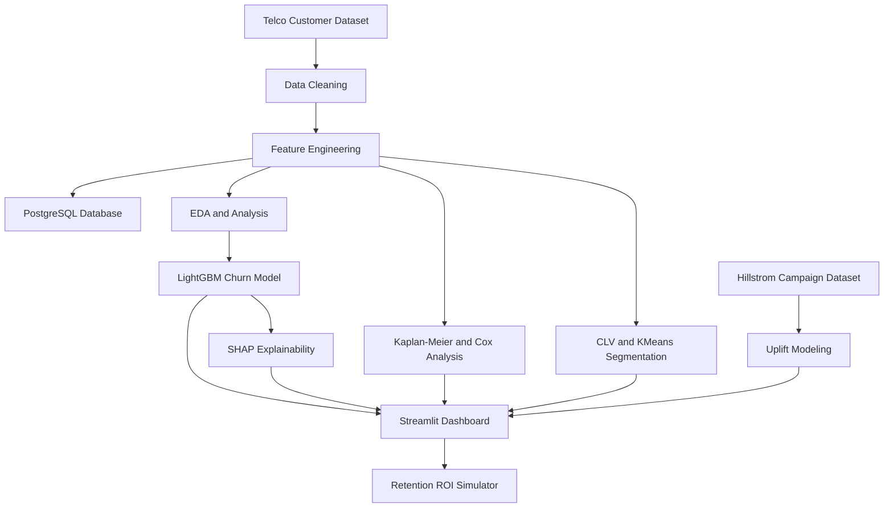

# System Architecture

## Overview

The Customer Lifetime Value and Churn Intelligence System combines customer data processing, churn prediction, survival analysis, customer segmentation, uplift modeling, and retention ROI analysis.

## Architecture

## Main Components

1. **Data processing:** Cleans the IBM Telco dataset and prepares customer features.
2. **Database:** Loads cleaned and engineered customer tables into PostgreSQL.
3. **Churn prediction:** Trains Logistic Regression and LightGBM models.
4. **Explainability:** Uses SHAP to interpret churn predictions.
5. **Survival analysis:** Uses Kaplan-Meier and Cox proportional hazards.
6. **Customer intelligence:** Estimates revenue-based CLV proxies and segments customers using KMeans.
7. **Uplift modeling:** Uses the Hillstrom campaign dataset to estimate the incremental effect of email treatment.
8. **Dashboard:** Presents customer insights, model metrics, explanations, uplift results, and ROI scenarios.

## Dashboard Data Flow

The Streamlit dashboard reads processed CSV files and saved model artifacts. PostgreSQL is populated by a separate data-loading script; the dashboard does not currently query PostgreSQL directly.

## Important Distinction

The Telco churn dataset and Hillstrom campaign dataset serve different purposes. Uplift modeling is performed on Hillstrom data, not on randomized treatments in the Telco dataset.
